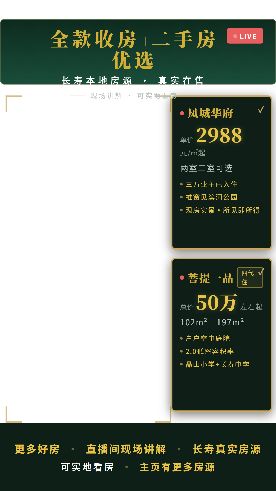

# 翡翠金 · 透明洞版

深翡翠绿底 + 金描边的直播背景板，右侧单卡合并两个楼盘做对比，中间透明洞留给主播。

## 文件说明

| 文件 | 说明 |
|---|---|
| `index.html` | 背景板源文件（405×720 设计画布，浏览器直接打开可预览） |
| `preview-1080x1920.png` | 导出成图（1080×1920，直接做直播素材） |

## 设计规格

- **画幅**：竖屏 9:16；设计稿 405×720，导出 1080×1920
- **配色**：翡翠绿底 `#0d2b1e` / `#1a4d3a` + 翡翠金 `#d4af37` / `#e8c547`
- **布局**：
  - **顶部通栏**：双大标题「全款收房｜新房」+「二手房优选」，同为 28px 900 金色衬线；第三行小字「长寿本地房源 · 真实在售」带横线装饰；背景板高 124px，文字收在板内
  - **中间透明洞**：偏左 251×370，四角金线定位，主播位置
  - **右侧房源卡**：单卡 + 1px 金线横隔，上凤城华府（现房 / 单价 2988 元/㎡起 / 两室三室可选 / ●现房实景所见即所得）、下菩提一品（四代住宅 / 总价 50 万左右起 / 102–197㎡ / ●户户空中庭院 ●2.0低密容积率 ●晶山小学+长寿中学）
  - **底部信息栏**：带看与联系信息
- **字体**：Noto Serif SC（标题）+ Noto Sans SC（正文）

## 设计取向

- **去通知感**：卖点用圆点 bullet 而非卡片框，视觉重量集中在价格数字（22px），避免右侧像系统通知列表
- **占位克制**：两张卡合并为一张，卡高从 372px 压到约 244px，侧边栏不铺满舞台
- **层级**：卡内按「名称 / 价格 / 信息 / 卖点」四段分区，头部有分隔线，单条 1px 55% 透明金描边

## 使用方法

1. 把 `preview-1080x1920.png` 导入 OBS / 抖音直播伴侣，置于摄像头图层下方
2. 改文案：编辑 `index.html` 文字，浏览器打开或用无头 Edge 导出 1080×1920

## 注意

- 顶部文字位于 36–119px，属于平台顶部 UI 理论覆盖区（抖音约 0–150px），紧凑与被遮是一对矛盾，**开播前必须用平台预览实测**；若被遮，改 `.top-bar` 的 `padding-top` 即可（36 → 60 / 100 / 130 三档）
- 数据来源：飞书房产知识库（凤城华府、璞缇一品销售材料）；价格政策以当月开发商口径为准
