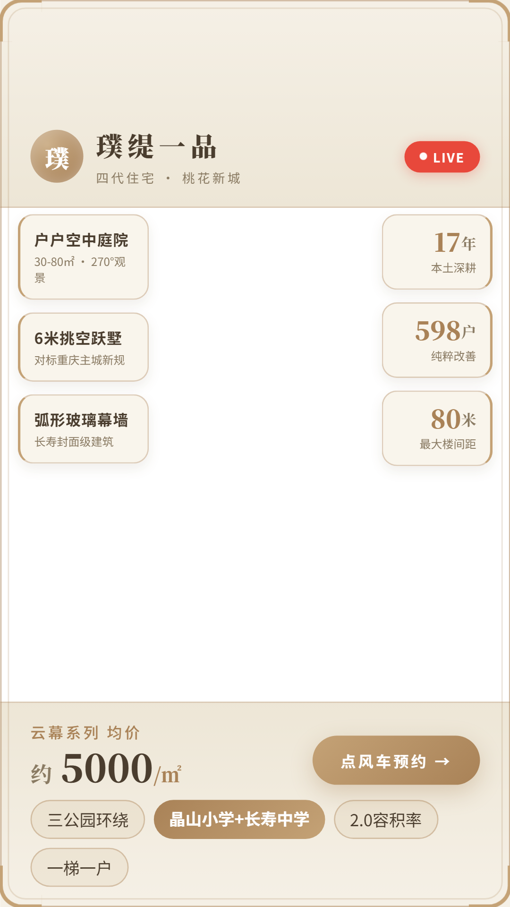

# 暖米白 · 浅木风

暖米白底 + 浅木描边的直播背景板，明亮日间感，单盘深度讲解版式（璞缇一品云幕系列）。

## 文件说明

| 文件 | 说明 |
|---|---|
| `index.html` | 背景板源文件（405×720 设计画布，浏览器直接打开可预览） |
| `preview-1080x1920.png` | 导出成图（1080×1920，直接做直播素材） |

## 设计规格

- **画幅**：竖屏 9:16；设计稿 405×720，导出 1080×1920
- **配色**：暖米白 `#F5F0E6` / `#EDE6D6` + 浅木 `#C4A276` / 深木 `#A98257` + 深棕文字 `#4A3D2E`
- **版式**：双层浅木画框（外 1px + 内 5px 内缩线，圆角 18px，四角 3px 木色描角），中间大留白作透明主播洞
- **布局**：
  - **顶部横幅**：圆形木色渐变 logo「璞」+ 楼盘名「璞缇一品」21px 衬线 + 副标「四代住宅 · 桃花新城」；右侧红色 LIVE 胶囊（含呼吸动画）
  - **左侧卖点卡**（104px 宽，左侧 2px 木色竖线 + 毛玻璃底）：户户空中庭院（30–80㎡ · 270°观景）/ 6米挑空跃墅（对标重庆主城新规）/ 弧形玻璃幕墙
  - **右侧数据卡**（88px 宽，右侧 2px 木色竖线）：17年 本土深耕 / 598户 纯粹改善 / 80米 楼间距
  - **底部横幅**：价格「云幕系列均价 · 约 5000/㎡」30px 衬线 + 金色渐变胶囊按钮「点风车预约 →」+ 四个 chip（三公园环绕 / 晶山小学+长寿中学(高亮) / 2.0容积率 / 一梯一户）
- **字体**：Noto Serif SC（数字与标题）+ Noto Sans SC（正文）

## 与翡翠金版的差异

| 维度 | 暖米白浅木风 | 翡翠金透明洞版 |
|---|---|---|
| 明度 | 亮色，日间/自然光场景更讨喜 | 深色，夜场、强对比更抓眼 |
| 结构 | 左右双栏卡（卖点↔数据）夹出透明洞 | 单侧房源卡对比双盘 |
| 内容 | 单盘深度（璞缇一品） | 双盘对比（凤城华府 / 菩提一品） |
| 顶部安全区 | `padding-top:100px`，天然避开平台顶部 UI | 顶栏 124px、文字自 36px 起，需开播实测 |

## 使用方法

1. 把 `preview-1080x1920.png` 导入 OBS / 抖音直播伴侣，置于摄像头图层下方
2. 改文案：编辑 `index.html` 里各卡片文字 → 浏览器打开预览 → 导出 1080×1920

## 待核事项

- 右侧「80米」标注为楼间距，若对外强调需确认是否为最大楼间距口径
- 「长寿封面级建筑」为宣传性表述，严格合规口径下建议改为客观描述（如「弧形玻璃幕墙 + 6 米挑空」）
- 价格 5000 元/㎡ 为云幕系列均价，以当月开发商口径为准
